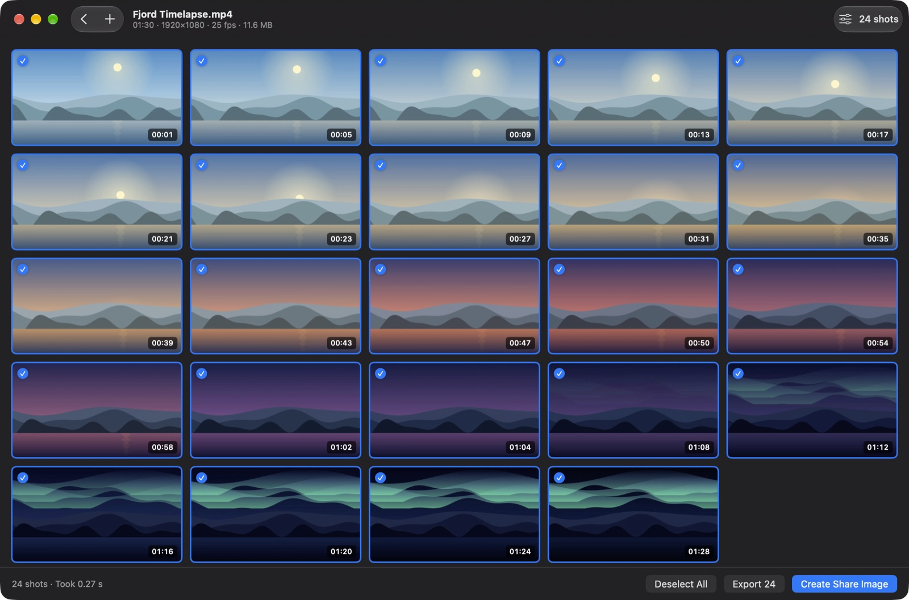

<p align="center"></p>

# Kvikkshot

A fast, fully local macOS app for taking screenshots from videos and turning them into one image to share. *Kvikk* is Norwegian for quick.

- Drop in one video or several and the screenshots start at once, by interval (every N seconds) or by count (N evenly spaced shots)
- Fast mode snaps to nearby keyframes; precise mode is exact to the frame
- Export as JPG or PNG, or build a share image with adjustable columns, width, background, timestamps and video details
- English, English (UK), Simplified Chinese and Traditional Chinese, following the system language
- Runs in the App Sandbox with no network access; cached screenshots are deleted on Back, on quit, and at the next launch after a crash ([privacy policy](PRIVACY.md))



**Download:** get the latest version from [Releases](https://github.com/tangfy97/Kvikkshot/releases) or [tang-spark.no/kvikkshot](https://tang-spark.no/kvikkshot.html), open it, and drag Kvikkshot to Applications. It is signed and notarized by Apple and needs macOS 14 Sonoma or later. A Mac App Store version is on its way.

## Build

Requires Xcode and [XcodeGen](https://github.com/yonaskolb/XcodeGen) (`brew install xcodegen`).

```sh
scripts/build.sh          # development build in build/Kvikkshot.app, signed to run locally
scripts/preflight.sh      # builds both release configurations and checks them before shipping
```

`project.yml` is the source of truth for the Xcode project; edit it rather than the `.xcodeproj`, then run `xcodegen generate`. The `Release` configuration is the website build and `AppStore` the Mac App Store build.

| Script | What it does |
|---|---|
| `scripts/release.sh` | Website build: Developer ID, notarized, as a DMG and zip in `build/release` |
| `scripts/appstore.sh` | App Store build: signed installer package, and `upload` sends it to App Store Connect |
| `scripts/icon.swift` | Renders the app icon into the asset catalog |
| `scripts/sample-video.swift`, `scripts/storeshot.swift` | Sample footage and App Store screenshot composition |

Releasing, App Store Connect values and listing copy: [docs/APP_STORE.md](docs/APP_STORE.md). The website pages: [docs/WEBSITE.md](docs/WEBSITE.md).

## License

Copyright © 2026 TangSpark. Released under the [Apache License 2.0](LICENSE). Contributions: [CONTRIBUTING.md](CONTRIBUTING.md). Security: [SECURITY.md](SECURITY.md).
